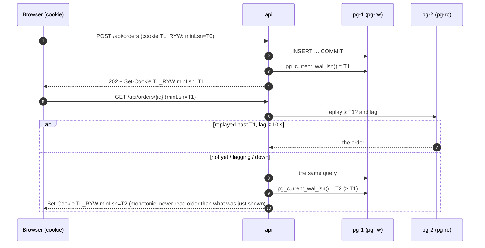

# Read routing with read-your-writes for TicketLite (D1)

| | |
|---|---|
| **Authors** | Hien V. Mai (owner), Claude (draft) |
| **Reviewers** | Hien V. Mai |
| **Status** | Implemented, in review (PR #43). Depends on A1 (PR #41) |
| **Created / updated** | 2026-11-25 / 2026-11-26 |
| **Roadmap** | D1 ([roadmap](../roadmap.md)); follow-up D5 |
| **Related** | [A1 Postgres replica](2026-11-22-postgres-replica.md), [U1 brief outages](2026-11-24-graceful-db-outage.md), [learn/15](../learn/15-data-intensive.md) (concepts and the replication flows) |

## 1. Context and scope

TicketLite (concert ticket sales: web, api x2, worker x2) stores users, concerts and orders in
Postgres. Since A1 the CloudNativePG cluster `pg` has two instances:

- **pg-1**, the primary, on node-workstation (NVMe). All writes go here.
- **pg-2**, an asynchronous streaming replica (hot standby), on node-8gb (USB SSD). It is usually under a second behind.

CNPG publishes two services: `pg-rw` (always the primary) and `pg-ro` (the replicas).

Before this design the api sent **every** query, reads included, to `pg-rw`. Two consequences:

1. **No read capacity from the replica.** One node does all database work; the other holds a full copy and serves nothing.
2. **Reads fail with writes during a failover.** While the primary is down (≤ 75 s measured, A1), even the concert list and "my orders" fail, although pg-2 has all the data.

This document covers **where each TicketLite read is served** and **which consistency each read gets**.

Out of scope:
- write scaling (single leader stays: D4)
- write durability (synchronous replication: D2)
- other apps

## 2. Goals and non-goals

### Goals

| # | Goal | Measured by |
|---|---|---|
| G1 | Reads that tolerate staleness are served by the replica | `ticketlite_db_reads_total{target="replica"}` takes the majority of reads in steady state |
| G2 | **Read-your-writes**: a user always sees their own writes, immediately | e2e: order readable right after `POST /orders`, also with the replica paused |
| G3 | **Monotonic reads**: a user never sees older data after newer data | unit test (the token only moves forward) + e2e |
| G4 | **Linearizable** sale decisions (stock, per-person limit) | only `pg-rw` + the Redis gate serve them; code review checklist (section 5.3) |
| G5 | Degrade, don't fail: replica lagging, down or absent → primary, automatically | e2e: paused / stopped replica |
| G6 | Reads keep working while the primary is down | e2e: primary stopped → reads 200, purchase 503 |
| G7 | Safe to deploy with **mixed versions** (rolling update) and existing sessions | e2e: purchase on an old pod, poll on a new pod |

### Non-goals

- More than one replica, or balancing between replicas (with one replica, G3 holds by construction).
- Cross-device read-your-writes (a purchase on the phone, seen on the laptop within the lag): D5, section 10.
- Writes on more than one node, sharding: D4.
- Zero data loss on failover: D2.
- A general database proxy for all apps.

## 3. Overview

Each Repo method declares the consistency it needs. A small router (`ReadRouter`) holds two
connection pools and decides per query:

```text
                     ┌──────────────── api pod ────────────────┐
 request ──► route ──► Repo method ──► ReadRouter ──┬── pg-rw ──► pg-1 primary
             call.readCtx (token from the session)  │
                                                    └── pg-ro ──► pg-2 replica
```

| Consistency | Who | Served by |
|---|---|---|
| eventual | anonymous users: concert list, login; the `/metrics` gauge | replica (if lag ≤ 10 s) |
| read-your-writes + monotonic | logged-in users: my orders, order status, tickets held | replica **if it has replayed past the user's token**, else primary |
| linearizable | everything inside a purchase (stock, limits, insert) | primary |
| write | api inserts, worker confirmations | primary |

**The token** is a Postgres LSN (log sequence number, a position in the write-ahead log), stored
as `minLsn` in its own signed cookie `TL_RYW`. It means "this browser has seen the database up to
here". It deliberately lives outside the session cookie (4.5).

**The rule:** the replica serves a logged-in user only when `pg_last_wal_replay_lsn() ≥ minLsn`.
Postgres replays the log strictly in order, so a replica past that point contains every change
the user has written or seen.

## 4. Detailed design

### 4.1 Token lifecycle



When the token moves:
- **after a write** (the commit is done, so the LSN read afterwards is past the commit record)
- **after a read served by the primary**, set to the primary's current position (monotonic reads)

It **never moves backwards**: LSNs are compared as 64-bit numbers, not as text (`16/…` > `9/…`).

### 4.2 Routing decision (per read)

In order:

| # | Condition | Served by | Metric `reason` |
|---|---|---|---|
| 1 | no replica configured (`DATABASE_READ_HOST` unset) | primary | `no_replica` |
| 2 | **logged in, but no token** (`ReadCtx.unknown`) | primary, then token := primary LSN | `no_token` |
| 3 | replica failed in the last 30 s (circuit breaker open) | primary | `replica_down` |
| 4 | replica unreachable, or dies mid-query | primary (the read is safe to repeat); breaker opens | `replica_down` |
| 5 | replica lag > `DB_READ_MAX_LAG_SECONDS` (10) | primary | `lagging` |
| 6 | replica has not replayed past the token | primary | `not_caught_up` |
| 7 | otherwise | **replica** | `ok` |

Rule 2 is the important one for safety. A logged-in user without a token is **unknown, not
fresh**. That user has a session from before this feature, or bought on an old pod during the
rolling update. The system cannot tell what they have seen, so the primary answers first and sets
the token. The cost is one primary read per such session, once.

The replica's state comes from one query on the replica connection, before the real query:

```sql
select not pg_is_in_recovery() or pg_last_wal_replay_lsn() >= $token::pg_lsn,
       case when not pg_is_in_recovery() or pg_last_wal_receive_lsn() = pg_last_wal_replay_lsn() then 0
            else coalesce(extract(epoch from now() - pg_last_xact_replay_timestamp()), 0) end
```

- The lag is 0 when the replica has replayed everything it received. An idle primary is not lag; the naive "now - last replay timestamp" would count an idle primary as lag.
- `not pg_is_in_recovery()` covers a just-promoted former replica that `pg-ro` still points at: it is current by definition.

### 4.3 Request context (where the token lives in the code)

- `call.readCtx` (`ReadConsistency.kt`) creates the request's `ReadCtx` on first use: logged in = a session exists; the token comes from `TL_RYW`. When the router moves the token, a callback writes `TL_RYW` **at once**, so the response's `Set-Cookie` carries it, error answers included.
- Routes never load or save tokens. They pass `call.readCtx` to the Repo.
- Every Repo read and write **requires** a `ReadCtx` parameter (not nullable). A new route cannot forget it: the compiler rejects the call.
- Anonymous reads use `ReadCtx.anonymous()` explicitly. "Eventual" is a visible choice in the code, not a default.
- `TL_RYW` is re-sent only when the token changes, not on every read. The session cookie is never rewritten by this feature.

Implementation note: the first version saved the token in a Ktor `onCallRespond` hook. A unit test
showed it was too late: the Sessions plugin had already prepared the cookie. The callback approach
has no hook-ordering dependency.

### 4.4 Connection pools

| Pool | Target | Settings | Why |
|---|---|---|---|
| primary | `DATABASE_URL` (`pg-rw`) | 5 connections, connect timeout 5 s (U1) | unchanged |
| replica | `DATABASE_READ_HOST` (`pg-ro.data.svc.cluster.local`) + the primary's user, password and database | read-only, connect timeout **1 s**, **does not block startup** | a dead replica costs at most 1 s once, then the breaker skips it; the api starts without a replica |

### 4.5 Data model: a separate cookie, not a session field

New cookie `TL_RYW` = `ReadToken(minLsn)`:
- signed with the same secret as the session
- `HttpOnly`, `Secure`, `SameSite=Lax`, 8 h, path `/`
- per browser; it outlives a logout and the next login (it can only make reads stricter)

`UserSession` (`TL_SESSION`) is **unchanged**. That is a compatibility decision, found by testing:
Ktor's default session decoder **rejects unknown keys** (`JsonDecodingException: Encountered an
unknown key 'minLsn'`). The first version added `minLsn` to `UserSession`. During a rolling update
a request reaching a pod of the previous version would then fail to decode the session, and the user
would look logged out. The same would happen on every rollback.

A separate cookie is ignored by pods that don't know it, in **both** directions. Unit test: the
session format is byte-compatible with the pre-D1 class both ways, and an extra key really breaks
decoding.

General rule recorded for this codebase: **never add a field to a session class in one release.**
Use a new cookie, or two releases (first teach every pod to ignore the key, then write it).

### 4.6 Failure modes

| Situation | Behaviour |
|---|---|
| replica paused / slow | logged-in users: primary (`not_caught_up`); everyone after 10 s lag: primary (`lagging`) |
| replica down | 1 s once, then 30 s on the primary (`replica_down`), retried after |
| **primary down** (failover in progress) | the replica answers all reads: list, login, my orders, status. Purchases get 503 + "not placed" (U1) |
| after promotion | `pg-ro` has no endpoints until the old primary rejoins: breaker → new primary |
| replica disconnected from the primary but up | it stops advancing; its lag reads 0 (it replayed all it received). Anonymous reads may be stale beyond 10 s; logged-in reads stay correct (token check fails → primary). Alert `PostgresReplicaNotStreaming` after 15 min (A1). Accepted, the stock shown comes from Redis anyway |
| LSNs across a failover | they keep growing on the new timeline, so existing tokens stay valid |

## 5. Alternatives considered

| Option | Pros | Cons | Verdict |
|---|---|---|---|
| **A. App routing with LSN tokens** (chosen) | exact guarantee per read; no new component; degrades per query | code in the app; per-device token (D5) | chosen |
| B. Time window: after a write, primary for N s (Rails' database selector, 2 s) | simple, no LSN logic | a guess: lag can exceed N (load, replica restart), and the guarantee then breaks silently; no monotonic reads | rejected: correctness depends on luck |
| C. Proxy decides (Pgpool-II, a smart load balancer) | no app code | a proxy cannot know a read's guarantee; coarse lag checks; another component to run, upgrade and make HA | rejected |
| D. Synchronous `remote_apply`, then read anywhere | read-your-writes for everyone, cross-device | every commit waits for a Pi over Wi-Fi; writes stall when the replica is down | rejected for D1; durability is D2's topic (with `preferred`, not `remote_apply`) |
| E. Token in a server-side store per user (Redis) | cross-device; works with any authentication | Redis in the read path; one lookup per read | **follow-up D5** (section 10) |
| F. Keep everything on the primary | no change | G1, G6 not met | rejected |

### 5.3 Review checklist for new queries

A new Repo method answers one question: **what does the caller decide based on this value?**
- A sale or a limit decision → `reads.linearizable`.
- What the user sees about their own data → `reads.read(call.readCtx)`.
- Public data → `reads.read(ReadCtx.anonymous())`.

## 6. Cross-cutting concerns

### 6.1 Security

- `TL_RYW` is **signed** like the session (HMAC, `SESSION_SECRET`), `HttpOnly`, `Secure`. A client can't change it.
- A forged value could only affect that user's own routing (worse case: their reads all go to the primary).
- No new secret: the replica connection reuses the app's credentials. CNPG's `pg_hba` allows the app user on replicas.
- The replica pool is read-only (`readOnly=true`), so an accidental write through it fails.

### 6.2 Privacy

The token is a WAL position, not user data. Nothing new is logged.

### 6.3 Observability

- `ticketlite_db_reads_total{target, reason}` (section 4.2). Every reason is pre-registered at 0 so dashboards and `increase()` are exact.
- Replication health comes from A1: alerts `PostgresReplicaNotStreaming`, `PostgresReplicationLag`; `verify.yml` checks streaming.
- Healthy steady state: `target="replica"` dominates; `no_token` appears only around releases.

### 6.4 Performance and capacity

- One extra small query per replica read (two function calls on the replica). In exchange the real query leaves the primary.
- A primary fallback adds one `pg_current_wal_lsn()`.
- TicketLite's volume is small; the aim is correct placement and failover behaviour, not throughput.

### 6.5 Reliability and SLOs

- Read availability now survives the primary's death (G6).
- The availability SLO (99.5 %) still counts purchase 503s during a failover.

### 6.6 Compatibility, mixed versions

| Combination (rolling update) | Result |
|---|---|
| session without `TL_RYW` → new pod | rule 2 → primary first, `TL_RYW` set |
| new pod sets `TL_RYW` → the next request hits an old pod | the old pod ignores the unknown cookie; the session is unchanged, so the user stays logged in (rollout e2e, rollback step: 200, not 401) |
| purchase on an old pod, poll on a new pod | rule 2 → primary → 200 (rollout e2e) |

## 7. Rollout plan

### 7.1 Order and gating

1. A1 (#41) merged and healthy: `kubectl cnpg status pg` shows 2 instances, 1 streaming.
2. D1 (#43) merged. CI builds the image, and Flux rolls out the api with `DATABASE_READ_HOST`. Order doesn't matter technically: without a replica, rule 1/3 send everything to the primary.

### 7.2 Watch after deploy (15 min)

- `ticketlite_db_reads_total`: `ok` grows; `no_token` spikes once, then stays flat
- no new 5xx in the SLO dashboard
- U1 metric `ticketlite_dependency_unavailable_total` stays flat

### 7.3 Rollback

- Remove `DATABASE_READ_HOST` from `k8s/apps/ticketlite/backend.yaml` (one-line PR). Every query goes to the primary again, with the same image.
- A full image rollback also works: old pods ignore `TL_RYW`, and users stay logged in (tested, 6.6).

### 7.4 Existing sessions

No action needed. No forced logout, no cookie migration. Each session gets its token on its first read (rule 2).

## 8. Testing

| Level | What | Result |
|---|---|---|
| unit | LSN ordering; the token only moves forward; `unknown` for logged-in users without a token; routing decisions; replica URL; old cookies decode | `ReadRouterTest` (7) |
| unit | `call.readCtx`: anonymous / unknown / known; a moved token reaches `Set-Cookie` in `TL_RYW` and the session cookie is not rewritten; no cookie on unchanged reads; after logout + login the token is kept | `ReadConsistencyTest` |
| unit | the session format is unchanged both ways; an extra key really breaks decoding | `ReadRouterTest` |
| e2e | real primary + streaming replica (`docker-compose.replica.yml`): reads on the replica; read-your-writes after a purchase; replica paused / stopped; **primary stopped → reads 200, purchase 503** | 2026-11-25, results in Appendix A |
| e2e | **rolling deploy**: purchase on the old image (no token), replica paused so it lacks the order, poll on the new image; then **roll back** to the old image | 2026-11-26: **200** via primary (`no_token`), token set, later reads back on the replica; after the rollback still logged in (200) |
| after deploy | metrics as in 7.2; `verify.yml` | pending |

## 9. Open questions

| # | Question | Owner / when |
|---|---|---|
| ~~Q1~~ | ~~Does an old pod accept a session with `minLsn`?~~ No, it rejects it: hence the separate `TL_RYW` cookie (4.5) | answered 2026-11-26 |
| Q2 | A Grafana panel for reads by target/reason on the TicketLite dashboard | with D1's deploy |

## 10. Future work

- **D5: cross-device read-your-writes, independent of the authentication method.** Store the token per user on the server (`lsn:user:<id>` in Redis) instead of only in the cookie. Then a purchase on the phone is guaranteed visible on the laptop, and API clients with JWTs or other non-cookie auth get the same guarantee. Cost: one Redis lookup per read; if Redis is down, the read goes to the primary. Same family as MongoDB's causal-consistency sessions (cluster time carried per session) and MySQL GTID waits.
- **D2: durability.** Synchronous replication with `preferred` durability.
- **D4: partitioning decision.**

## Appendix A. e2e results

Primary + streaming replica, the real api, web and worker (counts from `ticketlite_db_reads_total`):

| Step | Result |
|---|---|
| normal reads | 15 of 15 on the replica (`ok`) |
| purchase, then read the order at once | 200; CONFIRMED 2 s later |
| replica paused, purchase again | own new order 200 from the primary (`not_caught_up`); anonymous list from the primary after 10 s (`lagging`) |
| replica stopped | first read 1.0 s (connect timeout), then 16–33 ms (`replica_down`, breaker) |
| **primary stopped** | list, logged-in list, my orders, order status **all 200 from the replica**; purchase 503 |
| rolling deploy (old → new image, replica paused) | old pod: no token, replica lacks the order. New pod: 200 (`no_token`), token set; replica resumed → `ok` |
| rollback (new → old image) | still logged in: `/auth/me` 200, `/orders` 200 |

Bugs found by these tests, fixed before review:
1. the replica-state query had one placeholder but got two parameters, so the api did not start
2. the `/metrics` gauge read the primary on every scrape
3. the original rule "no token = nothing to wait for" broke read-your-writes for sessions created on old pods (rule 2)
4. saving the token in a late response hook missed the cookie (4.3)
5. a `minLsn` field in the session cookie would log users out whenever a request reached a pod of the other version (4.5)

## Appendix B. Glossary

LSN, read-your-writes, monotonic reads, linearizable, hot standby, circuit breaker:
[glossary](../learn/glossary.md); explained with examples in [learn/15](../learn/15-data-intensive.md).
