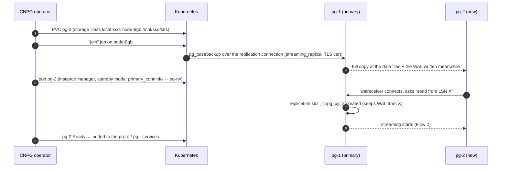
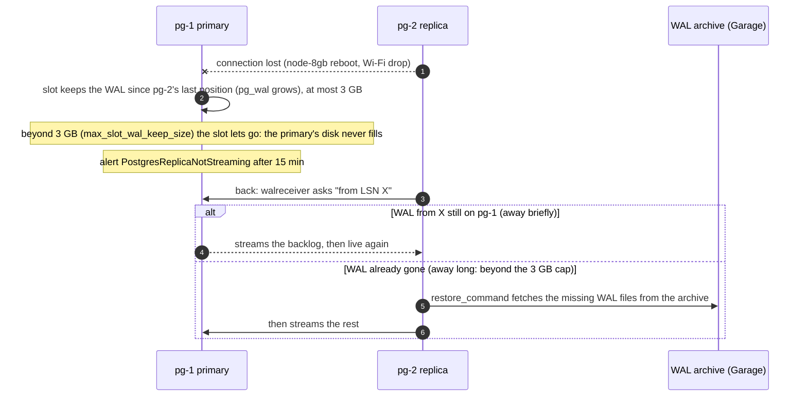

# 15. Data: one leader, many readers

Chapter 8 kept the **apps** alive by running 2 copies. Copies of an app are easy: they hold no
data, so any copy can answer any request. A **database** is different. If 2 copies both accept
writes, they can disagree. This chapter is about where data lives and who may change it. Book: Martin
Kleppmann, *Designing Data-Intensive Applications* (DDIA), chapters 5, 7 and 9.

## Who takes writes: a single leader

TicketLite's Postgres has 2 instances since A1:

```text
 writes ──► pg-1 PRIMARY (leader) ── WAL stream ──► pg-2 REPLICA (follower)
 reads  ──► wherever correct (below)
```

- The **primary** (leader) takes every write and records it in its write-ahead log (WAL).
- The **replica** (follower) replays that log, so it holds the same data, a moment later.

Why not let both take writes? Two people buy the last ticket at the same moment, one on each node.
Each node sees "1 left" and says yes: oversold. Systems with several leaders (or none, like
Cassandra) do exist, but they resolve conflicts *afterwards*, and a ticket sold twice can't be
fixed afterwards. Deciding "who got the last ticket" needs one place that orders all writes: a
single leader, or a consensus protocol (Raft, as in etcd) that makes several nodes agree first.

TicketLite also protects the leader from a rush:
- the **Redis gate** checks the stock and the per-person limit atomically and turns away the excess at once
- accepted orders go into a **Redis stream** (a log)
- **workers** confirm them in Postgres at a steady pace, re-checking under a row lock

This is admission control plus a queue: the leader sees a calm stream, not the spike.

## How pg-1 and pg-2 stay in sync: the flows

Where the pods run and the read/write paths of one purchase: [TicketLite in the cluster](../../apps/ticketlite/README.md#in-the-cluster-pods-nodes-and-data-paths).

The pieces, all managed by CloudNativePG (CNPG, the operator):

| Piece | Where | Job |
|---|---|---|
| **WAL** (write-ahead log) | `pg_wal/` on each instance | every change is first written here, in order; the data files follow later |
| **walsender** | a process on the primary | reads the WAL and streams it to the replica |
| **walreceiver** | a process on the replica | receives the WAL, writes it to the replica's own `pg_wal/` |
| **startup process** | on the replica | *replays* the received WAL into the data files, exactly as the primary applied it |
| **replication slot** `_cnpg_pg_2` | on the primary | remembers how far pg-2 has received: WAL it still needs is not deleted |
| user `streaming_replica` | both | the replication connection; TLS with a client certificate that CNPG creates and rotates (no password) |
| **instance manager** | PID 1 in every Postgres pod | starts/stops Postgres, reports status to the operator, answers the probes |
| **operator** | `cnpg-system` (2 copies since A1) | decides who is primary, creates replicas, runs failover, points `pg-rw` / `pg-ro` at the right pod |
| WAL archive | Garage on node-8gb's SSD (`ssd:cnpg`) | the primary also uploads each finished WAL file (at least every 5 min); a lagging replica can fetch from it |

### Flow 1: a new replica is born (once)

When `instances` goes from 1 to 2:



Observe: `kubectl -n data get jobs` (the join job), `kubectl cnpg status pg` (pg-2 "Standby (async)").

### Flow 2: one write, step by step (all the time)

A worker confirms an order (`UPDATE orders SET status='CONFIRMED' …; COMMIT`):

```mermaid
sequenceDiagram
    autonumber
    participant W as worker
    participant P as pg-1 primary
    participant S as walsender (pg-1)
    participant WR as walreceiver (pg-2)
    participant ST as startup process (pg-2)
    participant G as WAL archive (Garage)
    W->>P: UPDATE … COMMIT
    P->>P: WAL record written + flushed to pg-1's disk (fsync)
    P-->>W: COMMIT OK (asynchronous: does NOT wait for pg-2)
    S->>WR: the new WAL bytes (TCP, usually < 1 ms after the flush)
    WR->>WR: written + flushed to pg-2's pg_wal
    ST->>ST: replays the record into pg-2's data files
    Note over ST: now visible to reads on pg-2 (hot standby)
    WR-->>S: feedback: write / flush / replay LSN
    S->>P: slot _cnpg_pg_2 advances; old WAL may be recycled
    P->>G: later, when the 16 MB WAL file is full or after 5 min: archived
```

The 4 positions in step 7 are what `pg_stat_replication` shows on the primary, and they explain "lag":

| Column | Means | If it lags behind `sent_lsn` |
|---|---|---|
| `sent_lsn` | sent by the walsender | network (Wi-Fi) |
| `write_lsn` / `flush_lsn` | on pg-2's disk | pg-2's disk (USB SSD) |
| `replay_lsn` | applied, **visible to reads** | pg-2's replay (CPU, or a long read query holding it back) |

Observe: on pg-1:
```
select application_name, state, sent_lsn, write_lsn, flush_lsn, replay_lsn, replay_lag from pg_stat_replication;
```
On pg-2: `select pg_last_wal_replay_lsn();`. D1's read-your-writes check compares exactly this replay position with the user's token. Between step 3 and step 6 is the moment where a failover loses the write (asynchronous replication); D2 (synchronous) would move step 3 after step 5.

### Flow 3: the replica falls behind or disconnects



Why the cap matters: without it (Postgres' default is unlimited) a replica that is away for days
makes the primary keep every WAL file until its 10 Gi volume is full, and then the **primary**
stops: the replica that should add safety takes the database down. With the cap, the archive
(which has every WAL file anyway, for backups) covers the gap. CNPG's docs recommend setting it.

### Flow 4: failover (the primary dies)

Measured in the A1 lab (operator with 2 copies; numbers from the design doc):

```mermaid
sequenceDiagram
    autonumber
    participant N as node controller (k3s)
    participant Op as CNPG operator
    participant P as pg-1 (old primary)
    participant R as pg-2 (replica)
    participant Svc as pg-rw service
    participant App as TicketLite api
    Note over P: t=0 node dies: pg-1 gone, mid-stream
    App->>Svc: writes fail → 503 + Retry-After (U1); reads still from pg-ro (D1)
    N->>Op: ~45 s: node NotReady, pod pg-1 Ready=False
    Op->>Op: TargetPrimary = pending ("Failing over")
    Op->>P: shut down (unreachable: nothing to do, or immediate shutdown)
    Op->>R: stop the WAL receiver; pick the replica with the most WAL (lowest lag)
    R->>R: take the primary lease (Kubernetes Lease object; expires after 15 s if the old primary cannot release it)
    R->>R: promote: new timeline (2), accepts writes
    Op->>Svc: pg-rw → pg-2
    App->>Svc: next connection works (Hikari reconnects); ≤ 75 s in the lab
```

What is lost: WAL that pg-1 had committed (step 3 of Flow 2) but not yet sent. Normally under a
second of writes; 0 in the lab.

### Flow 5: the old primary comes back

```mermaid
sequenceDiagram
    autonumber
    participant P as pg-1 (old primary)
    participant R as pg-2 (new primary)
    participant Op as CNPG operator
    P->>P: instance manager starts; asks the operator: am I primary? → no
    P->>P: archives leftover WAL files first
    P->>R: pg_rewind: rewinds pg-1's data to where the timelines forked (its own unsent writes are discarded)
    P->>R: starts as a standby of pg-2, walreceiver connects (Flow 2, roles swapped)
    Op->>Op: pg-1 Ready → added to pg-ro
```

The primary now runs on node-8gb (the Pi). To move it back on purpose, use Flow 6.

### Flow 6: switchover (planned, no data lost)

`kubectl cnpg promote pg pg-1` (or set `targetPrimary`):

```mermaid
sequenceDiagram
    autonumber
    participant Op as CNPG operator
    participant Old as current primary
    participant New as chosen replica
    Op->>Old: fast shutdown (waits up to switchoverDelay): no new writes, remaining WAL sent + archived
    New->>New: has replayed everything: identical copy
    Op->>New: promote
    Op->>Op: pg-rw → New; Old restarts as its replica (no rewind needed)
```

Difference from a failover: the old primary shuts down **cleanly first**, so the replica has every
write. Only a few seconds without writes (the apps answer 503 and retry reads).

## Where reads go: by the guarantee each one needs

A replica is usually under a second behind. "A second old" is fine for some reads and wrong for
others, so each read says what it needs (D1, [design](../design/2026-11-25-read-routing.md)):

| Guarantee | Plain words | TicketLite example | Goes to |
|---|---|---|---|
| eventual | "a recent copy is fine" | the concert list, login | replica |
| **read-your-writes** | "I see what I just did" | right after buying: my order exists | replica only if it already has my write |
| **monotonic reads** | "time never goes backwards for me" | my order was CONFIRMED; reloading must not show PENDING | same check |
| **linearizable** | "the one true latest value" | is a ticket left? may I buy more? | Redis gate + primary only |

### How "the replica already has my write" is checked: LSN tokens

Every write in Postgres has a position in the WAL, the **LSN** (log sequence number, e.g.
`0/3000060`). It only grows.

1. After my write, the api asks the primary for its current LSN and keeps it in my session cookie (my **token**).
2. My next read goes to the replica, which first answers "how far have I replayed?" (`pg_last_wal_replay_lsn()`).
3. Replayed past my token: the replica serves my read. Not yet: the primary serves it, and my token moves to the primary's position, so I never see older data later.

This is an exact check, not a guess like "wait 2 seconds" (Rails' built-in database selector uses
such a time window; MongoDB's causal-consistency sessions and MySQL's GTID waits use positions, like
here).

Two details that matter in production (found by testing, [design doc](../design/2026-11-25-read-routing.md)):
- **No token is "unknown", not "fresh".** A logged-in user without a token (a session from before
  the feature, or a purchase on an old pod during a rolling update) reads from the primary first.
- **The token has its own cookie (`TL_RYW`).** Ktor rejects session cookies with unknown fields, so
  adding the token to the session would log users out whenever a request hit a pod of the other
  version. Rule: never change a session format in one release.

### When things break

| Situation | What happens |
|---|---|
| replica behind > 10 s | its reads move to the primary (`lagging`) |
| replica down | the first read waits 1 s, then a **circuit breaker** skips the replica for 30 s: no waiting on every request |
| **primary down** (failover) | reads still work from the replica (concert list, my orders); buying gets 503 + "not placed" until the replica is promoted (≤ 75 s) |

Measured in the e2e test; numbers in the design doc. See where reads go:
`curl -s <api>:8080/metrics | grep ticketlite_db_reads_total`.

## How safe is a write? (asynchronous replication)

Today the primary confirms a write **before** the replica has it (asynchronous). If the primary
dies in that moment, the newest writes (normally under a second) are lost in the failover. This is
the **RPO** (recovery point objective) of a failover.

**Synchronous** replication waits for the replica first: 0 loss, but every write is slower. If the
replica is down, writes either stop ("strict") or continue alone ("preferred"). Roadmap **D2**
chooses "preferred" for TicketLite: 0 loss while both run, never stuck when node-8gb is down.

## Why not split the data (partitioning / sharding)?

**Partitioning** (sharding) puts different rows on different leaders, e.g. concerts 1-1000 on one
node, the rest on another. It is how writes scale beyond one machine. It costs a lot:
- cross-partition queries
- rebalancing data between nodes
- transactions over several partitions

One Postgres primary handles thousands of writes per second; TicketLite has a handful. The rule
real teams use: partition when one leader can no longer keep up, and not before. Roadmap **D4**
writes the trigger down.

## Getting events out reliably (outbox)

Today the api inserts the order (Postgres) and then adds it to the queue (Redis): **two** systems,
two separate steps. If it crashes between them, the order exists but no worker hears about it.

The **outbox** pattern writes the event into a Postgres table in the **same transaction** as the
order. A relay then publishes it to the queue. This is called change data capture when it reads the
WAL itself (Debezium). Roadmap **D3**.

## Try it

```sh
cd apps/ticketlite
docker compose -f docker-compose.yml -f docker-compose.replica.yml up --build -d
curl -s localhost:8080/api/concerts >/dev/null; curl -s localhost:8081/metrics | grep db_reads   # target="replica"
docker compose exec replica psql -U app -d app -c 'select pg_wal_replay_pause()'   # replica stops replaying
docker compose stop postgres                                                         # the leader dies: reads still work
docker compose -f docker-compose.yml -f docker-compose.replica.yml down -v
```
